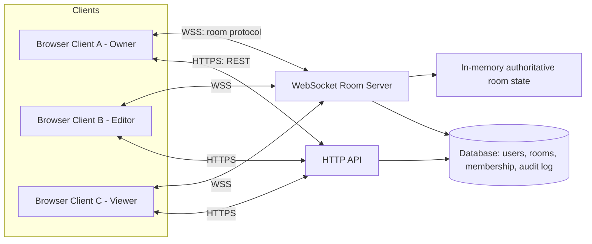

# Architecture

## 1. High-level shape



- **HTTP API** — auth (register/login), room CRUD (create room, fetch room metadata, list my
  rooms), membership/role management, audit log retrieval.
- **WebSocket Room Server** — one logical "room" process holds the authoritative state of that
  room's canvas elements + connected participants, and is the single source of truth broadcast to
  everyone connected. In v1 this lives in the same Node process as the API (single instance);
  the design isolates it behind a `RoomManager` interface so it can move to a dedicated
  service/Redis-backed pub-sub later without changing client code.
- **Database** — SQLite for local development via Prisma ORM; the same Prisma schema runs against
  Postgres in production by changing one config value (`DATABASE_URL` + provider).

## 2. Repository layout

```
/docs      product, requirements, architecture, security, roadmap (this set of documents)
/server    Node.js + TypeScript backend: HTTP API + WebSocket room server + Prisma/SQLite
/client    React + TypeScript frontend: canvas UI, auth screens, owner controls
/desktop   phase 2 — Electron wrapper notes/scaffold (not built in v1)
```

## 3. Backend design

### 3.1 HTTP API (`server/src/auth`, `server/src/rooms`)
- Express app, JSON over HTTPS.
- `POST /api/auth/register`, `POST /api/auth/login` → issue JWT.
- `POST /api/rooms` (create room, caller becomes Owner), `GET /api/rooms/:id`,
  `GET /api/rooms/mine`.
- All protected routes require `Authorization: Bearer <jwt>`, validated by middleware.

### 3.2 Room state & realtime protocol (`server/src/realtime`)
- Each room's live state (list of elements, connected participants, role map, lock/ended flags)
  is held in memory by a `RoomManager` (one entry per active room), and snapshotted to the
  database periodically and on every structural change (so a server restart doesn't lose room
  contents).
- Transport: raw `ws` WebSocket connections. On connect, the client sends a `join` message with
  its JWT (or guest token) and room id; the server validates, assigns a role, and replies with the
  full current room snapshot.
- Message types (JSON):
  - `join` / `joined` (snapshot + your assigned role + participant list)
  - `element:add` / `element:update` / `element:delete` — **client → server** requests;
    **server → all clients** broadcasts of the accepted, authoritative result.
  - `cursor` — lightweight, frequent, broadcast-only (not persisted).
  - `owner:setRole`, `owner:kick`, `owner:lock`, `owner:end` — **owner-only**, server enforces
    sender is the room Owner before acting; effects broadcast immediately (`role:changed`,
    `kicked` [closes that one socket], `room:locked`, `room:ended` [closes all sockets]).
- **Every mutating message is authorized server-side against the sender's current role before
  being applied or broadcast.** The client UI hides controls a role can't use, but that is a
  convenience only — the server is the actual enforcement point (see
  [05-security-and-permissions.md](05-security-and-permissions.md)).

### 3.3 Conflict handling (documented tradeoff)
v1 uses **authoritative-server + per-element last-write-wins**, not a CRDT:
- Each element carries a monotonically increasing `version` set by the server on every accepted
  update.
- Two Editors moving *different* elements at the same time: no conflict, both changes land.
- Two Editors editing the *same* element's *same* property at the same instant: the server accepts
  updates in arrival order; the later one wins; both editors see the final, converged result
  broadcast back (no silent divergence — that's the important guarantee, not perfect merge
  semantics).
- This is intentionally simpler than a CRDT (e.g. Yjs) and is sufficient for discrete UI elements
  (position/size/color/text-as-a-whole). It is **not** sufficient for fine-grained concurrent
  text editing inside the same text field character-by-character — that is called out as a
  phase-2/3 upgrade (swap the text-element's content model for a Yjs `Y.Text`) in
  [07-roadmap.md](07-roadmap.md), without needing to change the rest of the architecture.

## 4. Frontend design (`client/`)
- React + TypeScript + Vite.
- `AuthContext` — holds JWT, current user.
- `useRoomSocket` hook — owns the WebSocket connection, exposes room state (elements, participants,
  my role) and action dispatchers (`addElement`, `updateElement`, `deleteElement`, `sendCursor`,
  owner actions), and reconciles incoming broadcasts into local state.
- `RoomCanvas` — renders elements, handles drag/resize, forwards intents to `useRoomSocket`.
- `CursorLayer` — renders other participants' live cursors.
- `OwnerControlPanel` — visible only to the Owner; role changes, kick, lock, end.

## 5. Data model
See [04-data-model.md](04-data-model.md).

## 6. Known limitations (v1, by design)
1. Single-process room state — restarting the server drops live (non-persisted-yet) in-flight
   cursor state and requires clients to reconnect (they auto-reconnect and re-sync from the last
   snapshot).
2. Last-write-wins conflict model, not full CRDT (see §3.3).
3. No horizontal scaling out of the box — `RoomManager` is designed so a future Redis pub-sub
   backend can be dropped in without changing the WebSocket message protocol or client code.
